# Phishing Email Triage Lab

## Summary
A CompTIA Security+ live lab (2.3.7, Identify Social Engineering) in a simulated corporate environment. Working from George Fairbanks's webmail inbox, I reviewed 12 messages, hovered over links to read the real URL in the status bar, and decided whether to keep or delete each one.

I deleted eight messages. A fake Windows Update notice pointed to an .exe on a raw IP over plain HTTP. Jim Haws sent an unexpected executable attachment named tpmreport.exe. An executive recruiting lure led to an unrelated foreign domain. A Riverdale Estates HOA payment notice also used a raw IP over HTTP. Daisy Knudsen's "web site update" pointed to corpnet.ru, a look-alike of the real corpnet.xyz domain, and downloaded an .exe. Rachelle Hancock's "Wow!!" message used hype language and a suspicious Amazing.jpg attachment. Two chain letters from Grandma White, a virus warning and a free airline ticket offer, were hoaxes.

I kept four messages. A digitally signed Human Resources ethics-video notice linked to https://www.corpnet.xyz/videos/ethics.mp4, which is the real company domain over HTTPS. An internal LMS outage notice, a pumpkin contest email from the Activities Committee, and a routine presentation request from Bob Averez had no links, no attachments, and no requests for credentials.

## My Role
I completed this hands-on in CompTIA's live lab on November 24, 2026. As a security analyst reviewing a user's inbox, I opened each message in webmail, hovered over links to confirm the destination in the status bar, and inspected attachment names and icons when a file was present. I did not open the suspicious files. CorpNet and this inbox are part of the course lab, not a real workplace or my own network. The write-up is my own.

## Key Findings
- Hovering a link is what shows the real destination. Link text can say one thing while the status bar shows a raw IP, a look-alike domain, or an .exe download.
- Microsoft does not email Windows updates. A raw IP over plain HTTP that serves an .exe is a clear phishing indicator.
- A look-alike domain (corpnet.ru versus the real corpnet.xyz) is enough to reject a message, even when the sender looks familiar.
- Digital signatures (the green shield) provide authentication, integrity, and non-repudiation. The signed HR message also linked to the real company domain over HTTPS.
- Urgency alone does not make an email a phish. The LMS notice had a deadline, but it had no link, no attachment, and no request for credentials.
- Hoaxes spread because people forward them. A message from someone you know, like Grandma, is not automatically trustworthy.

## Indicators

| Indicator | Example in this lab |
| --- | --- |
| Raw IP in a link | `http://85.214.70.156/.../sp-update1018.exe`, `http://128.57.33.28/hoa.asp` |
| Plain HTTP and an .exe payload | Windows Update notice, Daisy Knudsen site update |
| Look-alike domain | corpnet.ru versus the real corpnet.xyz |
| Unexpected executable attachment | tpmreport.exe from Jim Haws |
| Mismatched attachment icon | Amazing.jpg (10.23 KB) with a program-style icon |
| Credential or information harvesting | `http://www.exec-recruiting.de/info/register.aspx` |
| Hoax or chain letter | Grandma White virus warning and free airline tickets |
| Urgency, flattery, or curiosity | payment pending, recruiting praise, "YOU'VE GOT TO SEE THIS" |

## Evidence

### 1. Windows Update notice (delete)
The link text did not match the real destination. Hovering showed `http://85.214.70.156/bilder/detail/windowsupdate/v10/sp-update1018.exe`: a raw IP, plain HTTP, and an .exe download. Microsoft does not email Windows updates.

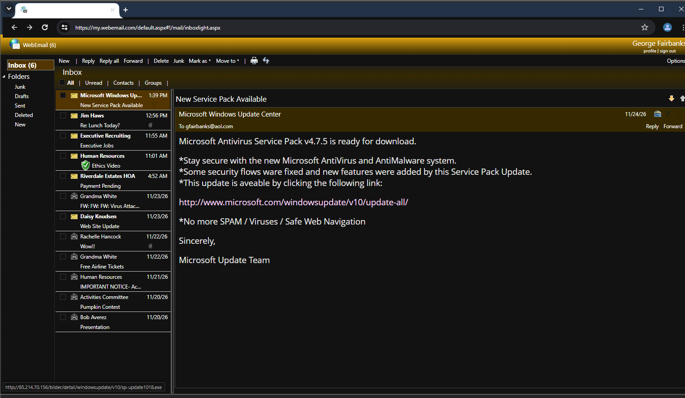

### 2. Jim Haws, unexpected executable (delete)
The message included an unexpected attachment named tpmreport.exe. An unsolicited executable from a coworker is a common malware delivery method, so I deleted it without opening the file.

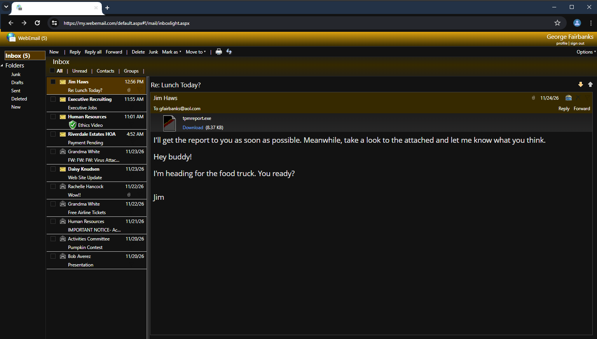

### 3. Executive Recruiting lure (delete)
The message used flattery to push a registration link. Hovering showed `http://www.exec-recruiting.de/info/register.aspx`, an unrelated foreign domain on plain HTTP, which is a credential and information-harvesting page.

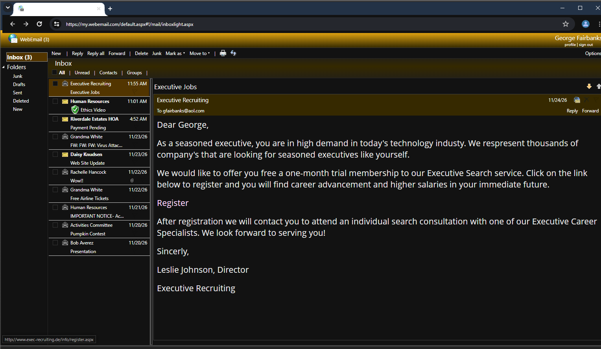

### 4. Human Resources Ethics Video (keep)
This message carried a digital signature (the green shield), which provides authentication, integrity, and non-repudiation. Hovering the "Watch now" link showed `https://www.corpnet.xyz/videos/ethics.mp4`, the real company domain over HTTPS.

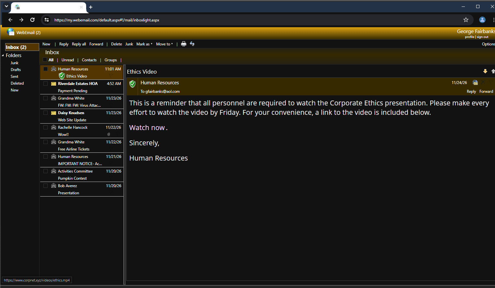

### 5. Riverdale Estates HOA, payment pending (delete)
The message used payment urgency to push a click. Hovering showed `http://128.57.33.28/hoa.asp`, another raw IP on plain HTTP.

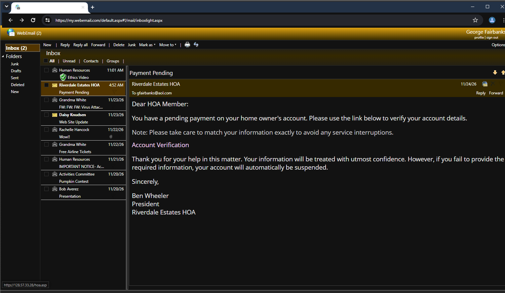

### 6. Grandma White virus warning (delete)
This is a hoax chain letter. It tells the reader a virus is spreading and urges them to forward the warning. There is no real remediation in a message like this, and forwarding it only spreads the hoax.

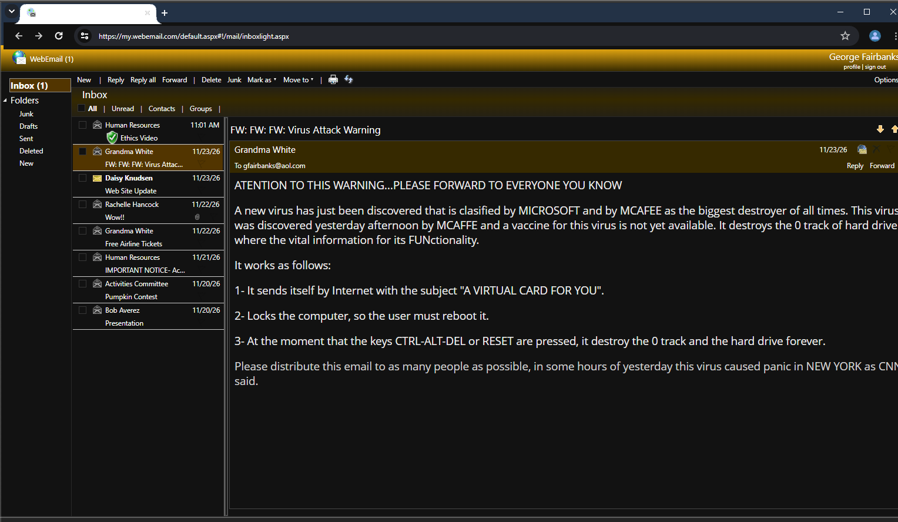

### 7. Daisy Knudsen web site update (delete)
Hovering the link showed `http://www.corpnet.ru/12afj.exe`. corpnet.ru is a look-alike of the real corpnet.xyz domain, the connection is plain HTTP, and the file is an .exe.

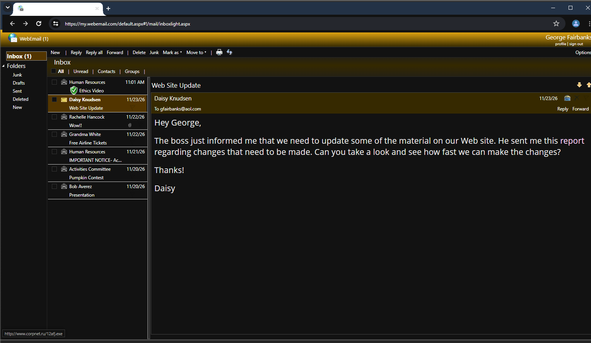

### 8. Rachelle Hancock, "Wow!!" (delete)
The body is a generic "Dear Friend" curiosity lure ("YOU'VE GOT TO SEE THIS!") with no real context. The attachment is named Amazing.jpg and is 10.23 KB, but it shows a program-style icon rather than a picture icon, which is consistent with a hidden double extension. I deleted it without opening the file.

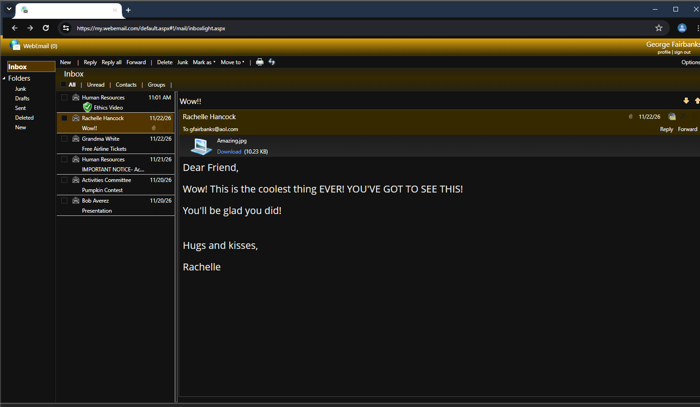

### 9. Grandma White, free airline tickets (delete)
This is another chain-letter hoax. It claims that forwarding the message to 10 people will produce free flights, which is too good to be true. No email system can track forwards that way, and no airline issues tickets for them.

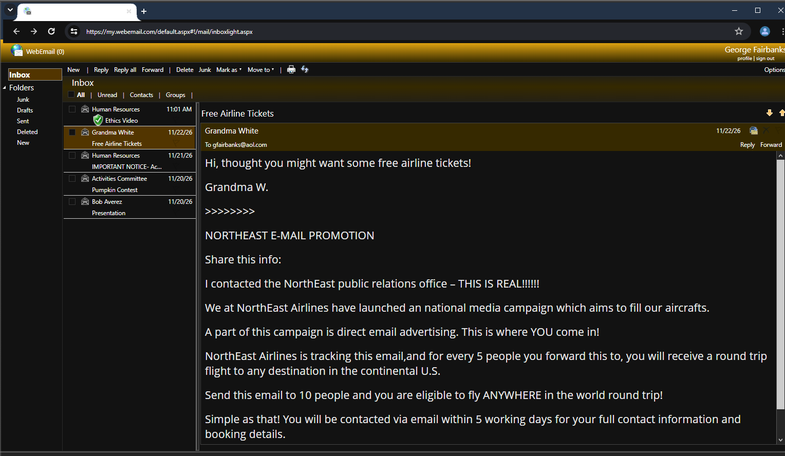

### 10. Human Resources, IMPORTANT NOTICE (keep)
The subject uses "IMPORTANT" and "Action required," but the message is a normal internal LMS notice. It has no links, no attachments, and no request for a password or personal information. It tells the reader to finish lessons in the company's existing training system, and the Friday deadline is explained by a scheduled outage with exact dates and times.

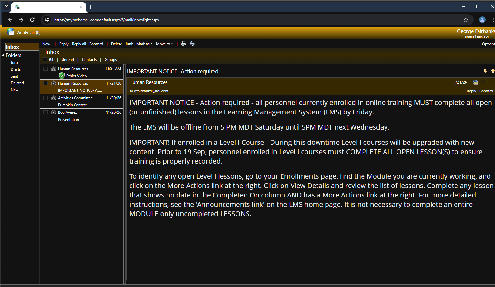

### 11. Activities Committee, Pumpkin Contest (keep)
This is a harmless office activity email. It has no links, no attachments, and no request for credentials. The only ask is to send a pumpkin photo for a montage.

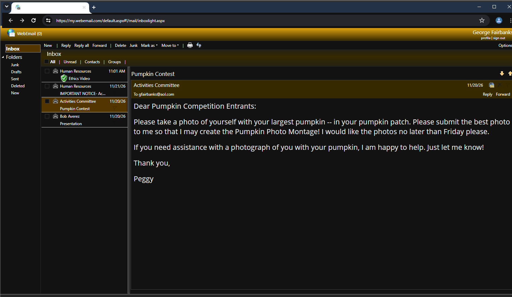

### 12. Bob Averez, Presentation (keep)
Bob asks which topics should be covered in the company meeting presentation. The message is addressed to George by name and has no links, no attachment, and no pressure.

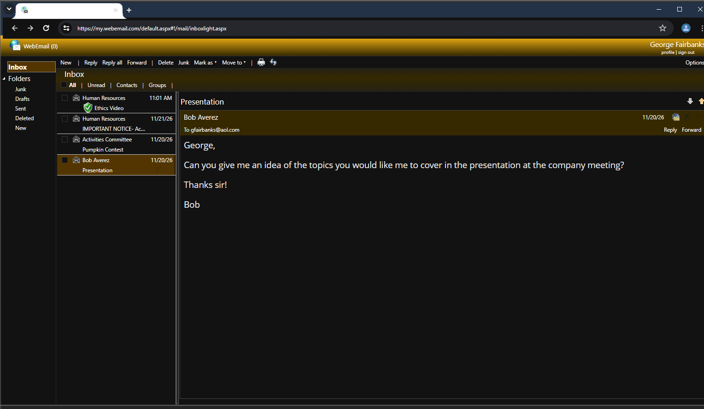

## Defensive Takeaways
- Hover every link and read the status bar before clicking. Link text is not proof of the destination.
- Treat raw IP addresses, plain HTTP, and unexpected .exe downloads as malicious.
- Compare domains carefully for look-alikes, such as corpnet.ru versus corpnet.xyz.
- Do not open unexpected attachments, even when the filename looks like an image. Check the icon and the full name.
- A digital signature is a strong keep signal when the link also matches the real domain over HTTPS.
- Do not forward chain letters or prize hoaxes. Knowing the sender does not make the message safe.
- Urgency by itself is not phishing. A real notice tells you to use a system you already have. A phish gives you its own link and tells you to log in there.

## Disclaimer
This is a CompTIA Security+ course live lab in a simulated environment. CorpNet is a fictional company used for training. The screenshots and write-up document my own work in that lab; they do not represent a real production network or employer.
